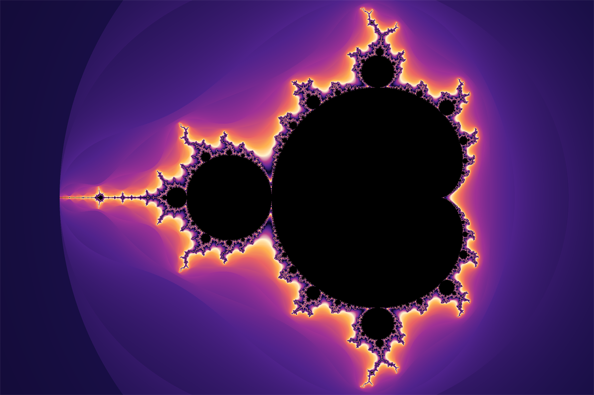
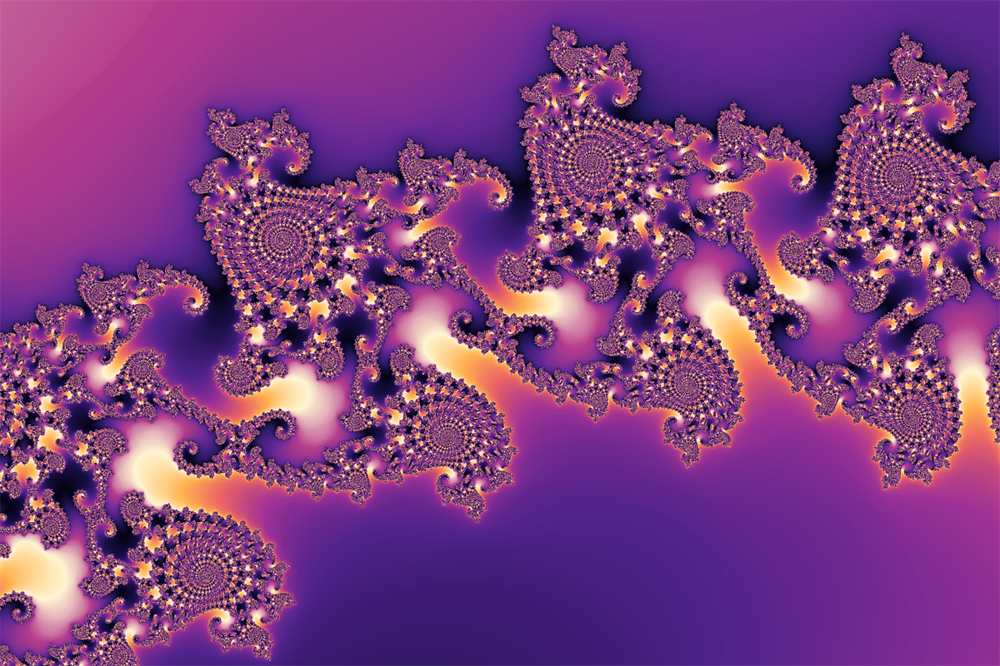

# FractalGeneration

[](https://github.com/McMorsh/FractalGeneration/actions/workflows/build.yml)
[](LICENSE)

Интерактивный визуализатор фракталов на C++20. Множества Мандельброта, Жюлиа
и Burning Ship считаются параллельно через OpenMP и выводятся в окне raylib.
Есть плавная раскраска, зум к курсору, фоновый расчёт кадров и экспорт PNG
до 8K.



## Возможности

- три фрактала: Мандельброт, Жюлиа и Burning Ship, переключение по `T`;
- сглаженная раскраска по непрерывному числу итераций;
- три палитры: Ember, Ocean и Mono;
- зум колесом к точке под курсором, панорамирование мышью и стрелками;
- копирование и вставка вида через буфер обмена (`C` и `V`);
- автоматический подбор числа итераций при зуме и ручная подстройка;
- параллельный расчёт через OpenMP и фоновый поток, интерфейс не блокируется;
- предпросмотр в половинном разрешении во время движения, полный кадр после остановки;
- изменение размера окна с пересчётом кадра;
- экспорт PNG без интерфейса в FHD, 2K, 4K или 8K;
- русский и английский интерфейс, выбор языка запоминается;
- рендер PNG без окна через командную строку;
- пересчёт только при изменении вида, а не каждый кадр.

Пример приближения к границе множества:



## Управление

| Действие | Клавиши и мышь |
| --- | --- |
| Приблизить или отдалить | Колесо мыши, `+` и `-` |
| Переместить изображение | Стрелки, левая кнопка мыши и перетаскивание |
| Скопировать или вставить вид | `C` и `V` |
| Увеличить или уменьшить число итераций | `[` и `]` |
| Сменить палитру | `P` |
| Сменить фрактал | `T` |
| Сбросить вид | `R` |
| Сохранить PNG в выбранном разрешении | `F2` |
| Выбрать разрешение PNG | `Shift + влево / вправо` |
| Показать или скрыть подсказки | `H` |
| Переключить язык интерфейса | `L` |
| Выход | `Esc` |

### Фракталы

Клавиша `T` переключает Мандельброт, Жюлиа и Burning Ship.

У Жюлиа параметр `c` меняется двумя ползунками в панели `Julia c` справа внизу:
`Re` и `Im`, диапазон -2...2. Значение по умолчанию `-0.8 + 0.156i`, начальный вид
центрирован в нуле с шириной 4, клавиша `R` возвращает к нему.

У Burning Ship параметра нет. Начальный вид центрирован около `(-0.5, 0.5)`
с шириной 4.

Выбранный тип и `c` сохраняются между запусками. Смена типа сохраняет текущий
вид, поэтому после переключения может понадобиться `R`. У Жюлиа при ширине окна
меньше 800 px панель подсказок скрывается, чтобы не перекрывать ползунки.

### Экспорт PNG

`F2` считает кадр в выбранном разрешении в фоне и сохраняет
`<фрактал>_ГГГГММДД_ЧЧММСС_4k.png`. Пресеты: FHD (1920x1080), 2K (2560x1440),
4K (3840x2160) и 8K (7680x4320). Текущий виден в HUD как `PNG 4K` и
переключается по `Shift + влево / вправо`. Выбор запоминается.

Кадр сохраняет вертикальный охват окна и расширяется по горизонтали до 16:9.
Интерфейс в PNG не попадает. На 8K расчёт занимает заметно больше времени
и требует больше памяти.

`F12` обрабатывает raylib и сохраняет `screenshotNNN.png` вместе с интерфейсом.
Для чистого PNG используйте `F2`.

### Буфер обмена

`C` копирует центр, span, зум, число итераций и палитру. `V` вставляет эти
параметры обратно, зум восстанавливается из span. Если в буфере нет подходящего
текста или параметры несовместимы, вид не меняется и появляется сообщение
об ошибке.

### Итерации

`[` и `]` меняют число итераций. Шаг 100, диапазон 50...5000. Удерживайте
клавишу, чтобы менять значение подряд. На границе нажатия игнорируются, поэтому
обратный шаг срабатывает сразу.

### Язык и настройки

`L` переключает русский и английский интерфейс. Заголовок окна, HUD, подсказки
и уведомления обновляются сразу.

Настройки хранятся в `settings.txt`:

- Windows: `%APPDATA%\FractalGeneration\settings.txt`;
- Linux: `$XDG_CONFIG_HOME/FractalGeneration/settings.txt` или
  `~/.config/FractalGeneration/settings.txt`.

Там же лежат палитра, пресет PNG, тип фрактала и `c` для Julia. Если файл
удалить, при следующем запуске снова будут русский язык, Ember, FHD и
Мандельброт. Настройки из старого каталога `MandelbrotFractalGeneration`
подхватываются автоматически.

Пример файла:

```text
language=ru
palette=Ember
fractal=julia
julia-re=-0.8
julia-im=0.156
png=4K
```

### Изменение размера окна

Окно можно потянуть за край или угол, минимальный размер 640x480. Фрактал
пересчитывается под новый размер, центр и масштаб сохраняются.

## Рендер без окна

Без `--output` запускается интерактивное окно. С `--output` приложение
рендерит PNG и сразу завершается:

```bash
./build-mingw/FractalGeneration.exe \
  --output mandelbrot.png \
  --width 1920 --height 1080 \
  --iterations 800 \
  --center -0.743643887037151 0.131825904205330 \
  --span 0.001 \
  --palette Ocean
```

| Опция | Значение |
| --- | --- |
| `-o, --output <file>` | путь к PNG, включает режим без окна |
| `--width <px>` | ширина изображения, по умолчанию 1200 |
| `--height <px>` | высота, по умолчанию 800 |
| `--iterations <n>` | число итераций, по умолчанию подбирается по `--span` |
| `--center <re> <im>` | центр окна, по умолчанию `-0.6 0` |
| `--span <value>` | ширина окна в комплексных единицах, по умолчанию 3.5 |
| `--palette <name>` | `Ember`, `Ocean` или `Mono` |
| `--fractal <name>` | `mandelbrot`, `julia` или `burningship`, по умолчанию `mandelbrot` |
| `-h, --help` | справка |

Имена палитр и фракталов не зависят от регистра. Опции `--width`, `--height`,
`--iterations`, `--center`, `--span`, `--palette` и `--fractal` действуют только
в режиме без окна. В GUI параметр `c` у Julia меняется ползунками, а headless
использует значение по умолчанию `-0.8 + 0.156i`. Для Burning Ship удобно
`--center -0.5 0.5 --span 4`.

## Как это работает

Для каждой точки `c` на комплексной плоскости вычисляется последовательность

```text
z₀ = 0
zₙ₊₁ = zₙ² + c
```

Итерации продолжаются, пока `|zₙ| ≤ 2`. Выход за этот предел означает, что
точка лежит вне множества, а число итераций до выхода задаёт цвет.

У Мандельброта `z₀ = 0`, а точкой плоскости является `c`. У Жюлиа наоборот:
точка плоскости задаёт `z₀`, а `c` постоянно и равно `-0.8 + 0.156i`, поэтому
для каждого `c` получается свой узор. У Burning Ship `z₀ = 0`, а `c` задаёт
точка плоскости, но перед каждым возведением в квадрат берутся модули
компонент: `zₙ₊₁ = (|Re zₙ| + i |Im zₙ|)² + c`.

Чтобы убрать ступени между соседними цветами, используется сглаженная оценка:

```text
μ = n + 1 - log₂(log₂ |zₙ|)
```

Точки, не вышедшие за предел за `max_iterations` шагов, считаются внутренними
и окрашиваются в чёрный.

### Палитры

| Палитра | Цвета | Назначение |
| --- | --- | --- |
| Ember | тёмно-фиолетовый, малиновый, оранжевый, кремовый | тёплый акцент на границе; тёмное начало цикла сливается с чёрной внутренностью |
| Ocean | тёмно-синий, бирюзовый, белый | холодная альтернатива, лучше разделяет тонкие полосы на глубоком зуме |
| Mono | серая шкала | проверка формы и сглаживания без влияния цвета |

Все палитры замкнуты: последний цвет близок к первому, поэтому при
зацикливании нет видимого шва. Длина цикла растёт с `max_iterations`, иначе
на глубоком зуме полосы становятся слишком частыми. Палитра переключается
по `P` и сохраняется в настройках.

## Сборка

Требования:

- компилятор с поддержкой C++20;
- CMake 3.21 или новее;
- OpenMP;
- raylib 5.x или новее;
- GoogleTest (для тестов).

### Windows (MSYS2 / MinGW)

Установите [MSYS2](https://www.msys2.org/) в `C:\msys64` и откройте терминал
**MSYS2 UCRT64**:

```bash
pacman -Syu
pacman -S --needed git mingw-w64-ucrt-x86_64-gcc \
  mingw-w64-ucrt-x86_64-cmake mingw-w64-ucrt-x86_64-ninja \
  mingw-w64-ucrt-x86_64-raylib mingw-w64-ucrt-x86_64-libgomp \
  mingw-w64-ucrt-x86_64-gtest
```

Сборка:

```bash
git clone https://github.com/McMorsh/FractalGeneration.git
cd FractalGeneration

cmake --preset mingw-release
cmake --build --preset mingw-release
./build-mingw/FractalGeneration.exe
```

Чтобы запускать exe из PowerShell или Проводника, не нужно вручную менять PATH:
CMake при сборке через MinGW сам копирует нужные DLL рядом с exe. Иконка окна
`assets/icon.png`, шрифт `assets/IBMPlexMono-Regular.ttf` и лицензия
`assets/OFL.txt` копируются в `assets/` рядом с exe, а `assets/icon.ico`
встраивается в сам файл.

### Linux

```bash
git clone https://github.com/McMorsh/FractalGeneration.git
cd FractalGeneration

# Зависимости raylib для Debian и Ubuntu
sudo apt update
sudo apt install build-essential cmake git curl zip unzip tar pkg-config \
  libgl1-mesa-dev libx11-dev libxrandr-dev libxi-dev libxcursor-dev \
  libxinerama-dev libasound2-dev libwayland-dev libxkbcommon-dev wayland-protocols

git clone https://github.com/microsoft/vcpkg "$HOME/vcpkg"
"$HOME/vcpkg/bootstrap-vcpkg.sh"
"$HOME/vcpkg/vcpkg" install raylib gtest

cmake -B build -S . -DCMAKE_BUILD_TYPE=Release \
  -DCMAKE_TOOLCHAIN_FILE="$HOME/vcpkg/scripts/buildsystems/vcpkg.cmake"
cmake --build build -j

./build/FractalGeneration
```

## Тесты

```bash
cmake --preset mingw-release
cmake --build --preset mingw-release
ctest --preset mingw-release
```

На Linux тесты запускаются через каталог сборки:

```bash
ctest --test-dir build --output-on-failure
```

Если тесты не нужны, сконфигурируйте проект без `BUILD_TESTING` или передайте
`-DBUILD_TESTING=OFF`.

## Структура проекта

| Путь | Назначение |
| --- | --- |
| `fractal_core/fractal.hpp`, `fractal_core/fractal.cpp` | Расчёт выбранного фрактала и сглаженных итераций |
| `fractal_core/fractal_type.hpp`, `fractal_core/fractal_type.cpp` | Тип фрактала, параметры Julia и разбор имени |
| `fractal_core/view.hpp`, `fractal_core/view.cpp` | Камера: зум, панорамирование и координаты |
| `fractal_core/iterations.hpp`, `fractal_core/iterations.cpp` | Автоматическое число итераций и ручная подстройка |
| `fractal_core/view_snapshot.hpp`, `fractal_core/view_snapshot.cpp` | Формат и разбор параметров вида для буфера обмена |
| `color_map/color_map.hpp`, `color_map/color_map.cpp` | Палитры и преобразование итераций в цвет |
| `app/command_line.hpp`, `app/command_line.cpp` | Разбор аргументов командной строки и справка |
| `app/headless.hpp`, `app/headless.cpp` | Рендер PNG без окна |
| `app/application.hpp`, `app/application.cpp` | Главный цикл, ввод, предпросмотр и экспорт |
| `renderer/export_presets.hpp` | Пресеты разрешения FHD, 2K, 4K и 8K |
| `renderer/fractal_render.hpp`, `renderer/fractal_render.cpp` | Окно, текстура и экранный интерфейс |
| `renderer/image_render.hpp`, `renderer/image_render.cpp` | Рендер и сохранение PNG без окна |
| `renderer/render_settings.hpp` | Общие параметры кадра для оконного и headless-рендера |
| `renderer/image_export_worker.hpp`, `renderer/image_export_worker.cpp` | Фоновый экспорт PNG в выбранном разрешении |
| `renderer/localization.hpp`, `renderer/localization.cpp` | Строки русского и английского интерфейса |
| `renderer/render_worker.hpp`, `renderer/render_worker.cpp` | Фоновый расчёт кадров |
| `renderer/settings.hpp`, `renderer/settings.cpp` | Сохранение и чтение настроек интерфейса |
| `main.cpp` | Точка входа: разбор режима и запуск приложения |
| `tests/` | Тесты GoogleTest для `CommandLine`, `Fractal`, `FractalType`, `Iterations`, `ColorMap`, `View`, `ViewSnapshot`, `ImageRender`, `ExportPresets`, `Localization` и `Settings` |
| `assets/` | Иконки, шрифт IBM Plex Mono и текст лицензии OFL |
| `docs/` | Изображения для README |

## Будущие улучшения

- другие фракталы, например Tricorn;
- кэш последних кадров для возврата к уже посещённому виду;
- рендеринг на GPU;
- готовые сборки в GitHub Releases.

## Лицензия

Проект распространяется по лицензии [MIT](LICENSE).

Шрифт IBM Plex Mono распространяется по SIL Open Font License 1.1.
Текст лицензии находится в `assets/OFL.txt`.
