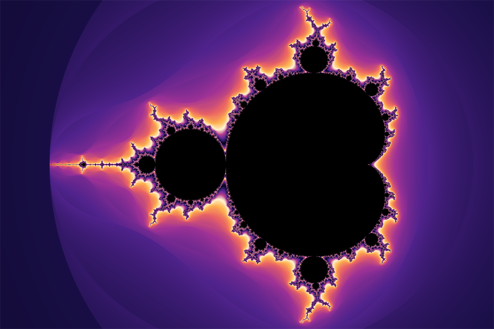
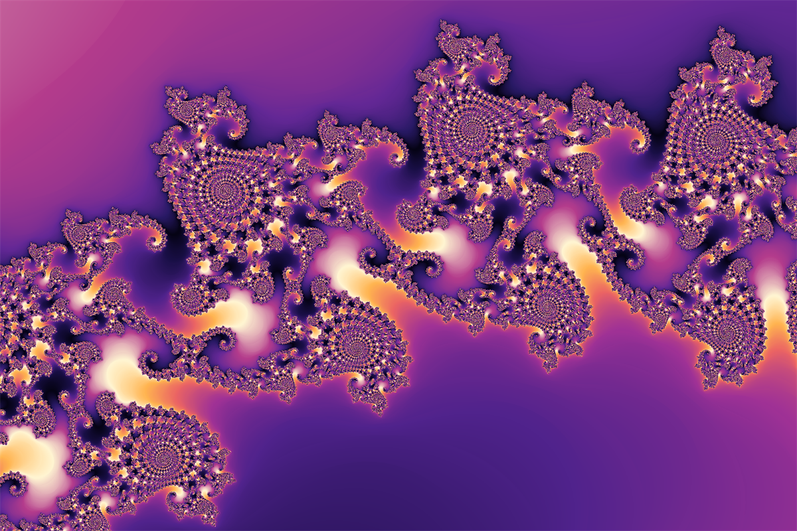

# MandelbrotFractalGeneration

[](https://github.com/McMorsh/MandelbrotFractalGeneration/actions/workflows/build.yml)

Визуализация множества Мандельброта на C++20. Пиксели считаются параллельно
через OpenMP, изображение выводится с помощью raylib.



## Возможности

- сглаженная раскраска на основе непрерывного числа итераций;
- три палитры (Ember, Ocean, Mono) с переключением по клавише;
- приближение колесом мыши к точке под курсором и панорамирование;
- автоматический рост числа итераций при приближении и ручная подстройка;
- параллельный расчёт строк изображения через OpenMP;
- сохранение изображения без интерфейса в PNG по F12;
- рендер PNG без окна с параметрами командной строки;
- пересчёт изображения только при изменении вида, а не каждый кадр.

Пример приближения к границе множества:



## Управление

| Действие | Клавиша |
| --- | --- |
| Приблизить или отдалить | Колесо мыши |
| Переместить изображение | Левая кнопка мыши и перетаскивание |
| Увеличить или уменьшить число итераций | `[` и `]` |
| Сменить палитру | P |
| Сбросить вид | R |
| Сохранить PNG | F12 |
| Показать или скрыть подсказки | H |
| Выход | Esc |

Сохранённое изображение не содержит панелей и подсказок. Файл
`mandelbrot_ГГГГММДД_ЧЧММСС.png` появляется в текущем каталоге.

## Рендер без окна

Без `--output` запускается интерактивное окно. С `--output` приложение
рендерит PNG и сразу завершается:

```bash
./build-mingw/MandelbrotFractalGeneration.exe \
  --output mandelbrot.png \
  --width 1920 --height 1080 \
  --iterations 800 \
  --center -0.743643887037151 0.131825904205330 \
  --span 0.001 \
  --palette Ocean
```

| Опция | Значение |
| --- | --- |
| `-o, --output <file>` | путь к PNG, включает режим без окна |
| `--width <px>` | ширина изображения, по умолчанию 1200 |
| `--height <px>` | высота, по умолчанию 800 |
| `--iterations <n>` | число итераций, по умолчанию подбирается по `--span` |
| `--center <re> <im>` | центр окна, по умолчанию `-0.6 0` |
| `--span <value>` | ширина окна в комплексных единицах, по умолчанию 3.5 |
| `--palette <name>` | `Ember`, `Ocean` или `Mono` |
| `-h, --help` | справка |

Имена палитр не зависят от регистра. Остальные опции относятся только к
режиму без окна.

## Как это работает

Для каждой точки c на комплексной плоскости вычисляется последовательность

```text
z₀ = 0
zₙ₊₁ = zₙ² + c
```

Итерации продолжаются, пока |zₙ| ≤ 2. Выход за этот предел означает, что точка
лежит вне множества, а число итераций до выхода задаёт цвет. Чтобы убрать
ступени между соседними цветами, используется сглаженная оценка:

```text
μ = n + 1 − log₂(log₂ |zₙ|)
```

Точки, не вышедшие за предел за `maxIterations` шагов, считаются внутренними
и окрашиваются в чёрный.
Палитра циклическая: цвет плавно переходит между опорными цветами и
зацикливается. Доступны три схемы: Ember, Ocean и Mono. Длина цветового цикла
растёт вместе с `maxIterations` (но не меньше 20 итераций), поэтому при
глубоком приближении полосы не становятся слишком частыми.

## Сборка

Требования:

- компилятор с поддержкой C++20;
- CMake 3.21 или новее;
- OpenMP;
- raylib 5.x или новее;
- GoogleTest (для тестов).

### Windows (MSYS2 / MinGW)

Установите [MSYS2](https://www.msys2.org/) в `C:\msys64` и откройте терминал
**MSYS2 UCRT64**:

```bash
pacman -Syu
pacman -S --needed git mingw-w64-ucrt-x86_64-gcc \
  mingw-w64-ucrt-x86_64-cmake mingw-w64-ucrt-x86_64-ninja \
  mingw-w64-ucrt-x86_64-raylib mingw-w64-ucrt-x86_64-libgomp \
  mingw-w64-ucrt-x86_64-gtest
```

Сборка:

```bash
git clone https://github.com/McMorsh/MandelbrotFractalGeneration.git
cd MandelbrotFractalGeneration

cmake --preset mingw-release
cmake --build --preset mingw-release
./build-mingw/MandelbrotFractalGeneration.exe
```

Чтобы запускать exe из PowerShell или Проводника, не нужно вручную менять PATH:
CMake при сборке через MinGW сам копирует нужные DLL рядом с exe.

### Linux

```bash
git clone https://github.com/McMorsh/MandelbrotFractalGeneration.git
cd MandelbrotFractalGeneration

# Зависимости raylib для Debian и Ubuntu
sudo apt update
sudo apt install build-essential cmake git curl zip unzip tar pkg-config \
  libgl1-mesa-dev libx11-dev libxrandr-dev libxi-dev libxcursor-dev \
  libxinerama-dev libasound2-dev libwayland-dev libxkbcommon-dev wayland-protocols

git clone https://github.com/microsoft/vcpkg "$HOME/vcpkg"
"$HOME/vcpkg/bootstrap-vcpkg.sh"
"$HOME/vcpkg/vcpkg" install raylib gtest

cmake -B build -S . -DCMAKE_BUILD_TYPE=Release \
  -DCMAKE_TOOLCHAIN_FILE="$HOME/vcpkg/scripts/buildsystems/vcpkg.cmake"
cmake --build build -j

./build/MandelbrotFractalGeneration
```

## Тесты

```bash
cmake --preset mingw-release
cmake --build --preset mingw-release
ctest --preset mingw-release
```

На Linux тесты запускаются через каталог сборки:

```bash
ctest --test-dir build --output-on-failure
```

Если тесты не нужны, конфигурируй с `-DBUILD_TESTING=OFF`.

## Структура проекта

| Путь | Назначение |
| --- | --- |
| `FractalCore/Fractal.h`, `FractalCore/Fractal.cpp` | Расчёт множества и сглаженных итераций |
| `ColorMap/ColorMap.h`, `ColorMap/ColorMap.cpp` | Палитры и преобразование итераций в цвет |
| `Renderer/FractalRender.h`, `Renderer/FractalRender.cpp` | Окно, текстура, интерфейс и экспорт PNG |
| `Renderer/ImageRender.h`, `Renderer/ImageRender.cpp` | Рендер PNG без окна |
| `main.cpp` | CLI, камера, обработка ввода и главный цикл |
| `tests/` | Тесты GoogleTest для `Fractal` и `ColorMap` |
| `docs/` | Изображения для README |

## Будущие улучшения

- другие фракталы: Julia, Burning Ship;
- фоновый расчёт кадра, чтобы панорамирование не блокировалось на глубоком зуме;
- рендеринг на GPU;
- готовые сборки в GitHub Releases.

## Лицензия

Проект распространяется по лицензии [MIT](LICENSE).
